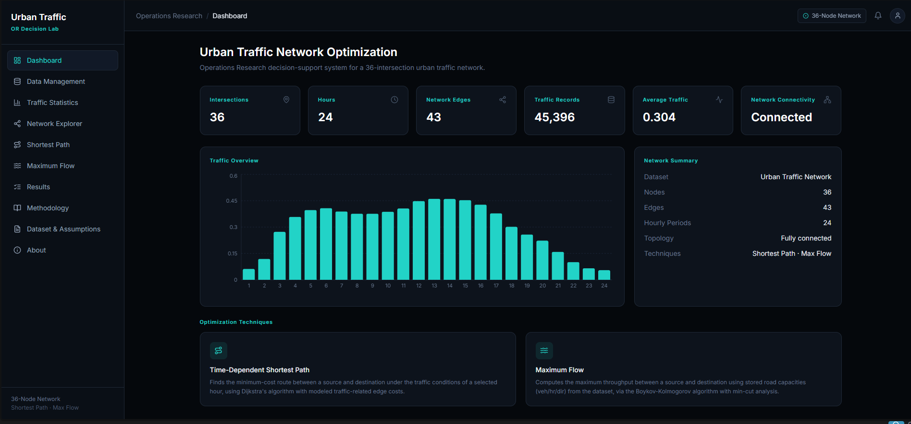
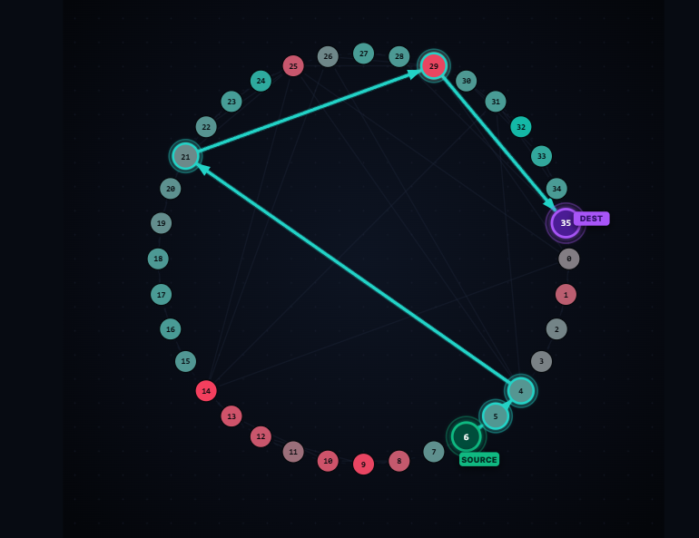

# Urban Traffic Network Optimization

An end-to-end Operations Research decision-support web application built around your
**existing** dataset and network algorithms:

- `train.csv` — 45,396 traffic observations across 36 intersections and 24 hourly periods
- `adj_matrix.csv` — 36×36 binary adjacency matrix (43 undirected edges)
- `edge_capacity.csv` — Physical road throughput limits (vehicles/hour/direction) for all 43 edges
- Time-Dependent Shortest Path (Dijkstra algorithm)
- Maximum Flow (Boykov-Kolmogorov algorithm with exact min-cut analysis and flow conservation)

## Project Structure

```
backend/
    main.py                    FastAPI app entrypoint
    dataset/                   train.csv, adj_matrix.csv, edge_capacity.csv
    api/                       Route handlers (dataset, statistics, network, shortest_path, max_flow, results)
    services/                  Core logic: dataset loading/caching, OR algorithms, statistics, results store
    models/                    Pydantic request schemas
    test_suite.py              Comprehensive test suite (35 automated tests)
frontend/
    src/
        pages/                 Dashboard, Data Management, Traffic Statistics,
                               Network Explorer, Shortest Path, Maximum Flow, Results,
                               Methodology, Dataset & Assumptions, About
        components/            Shared UI (NetworkGraph, MaxFlowNetworkGraph, NodeSelect, StatCard, StatusBadge, etc.)
        layouts/               Sidebar, TopBar, AppShell
        services/api.ts        Typed API client
        hooks/                 Shared hour-selection state, dataset status polling
        types/                 TypeScript interfaces matching backend response shapes
```

## Running the backend

Requires Python 3.10+.

```bash
cd backend
python -m venv venv
venv\Scripts\activate        # Windows
pip install -r requirements.txt
uvicorn main:app --reload --port 8000
```

The dataset is loaded and cached once at startup from `backend/dataset/`. Verify it's working:

```bash
curl http://localhost:8000/api/health
curl http://localhost:8000/api/dataset/status
```

Interactive API docs are available at `http://localhost:8000/docs`.

Run automated tests:

```bash
cd backend
python test_suite.py
```

## Running the frontend

Requires Node.js 18+.

```bash
cd frontend
npm install
npm run dev
```

Open `http://localhost:5173`. The Vite dev server proxies `/api/*` requests to
`http://localhost:8000`.

To build for production:

```bash
npm run build
```

## Web Application Screenshots

### Dashboard and Traffic Statistics


### Shortest Path Optimization


### Maximum Flow Optimization


## Optimization Techniques

1. **Shortest Path (Dijkstra)**
   - Computes the minimum-cost routing between any source and destination intersection.
   - Cost incorporates modeled traffic congestion for the chosen hour.
   - Outputs path traversal sequence, total travel cost, edge-by-edge breakdown, and interactive visual graph highlighting.

2. **Maximum Flow (Boykov-Kolmogorov)**
   - Computes peak throughput (vehicles/hour) between source and sink across the directed network.
   - Edge capacity is loaded directly from `edge_capacity.csv`.
   - Max-flow min-cut theorem verification (`max_flow == min_cut_capacity`).
   - Flow conservation strictly verified at all intermediate nodes ($\sum f_{in} = \sum f_{out}$).
   - Bottleneck road identification (edges saturated at 100% capacity).
